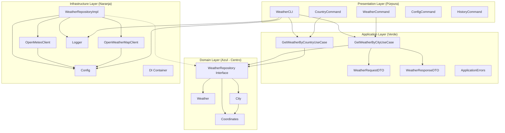
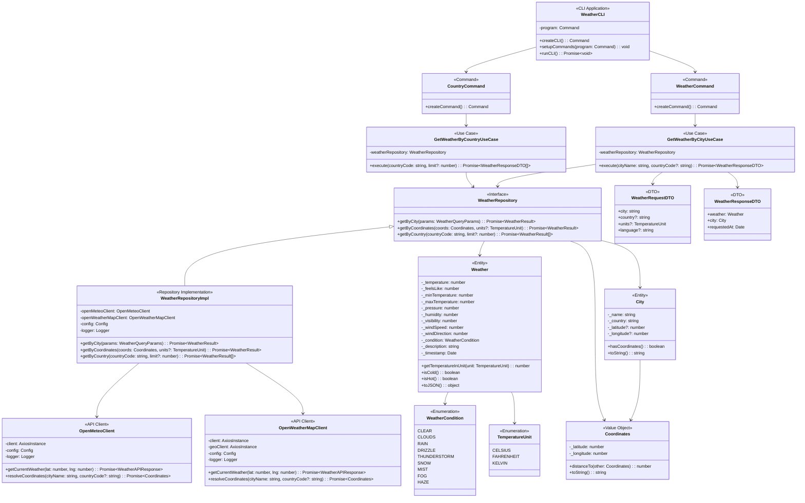
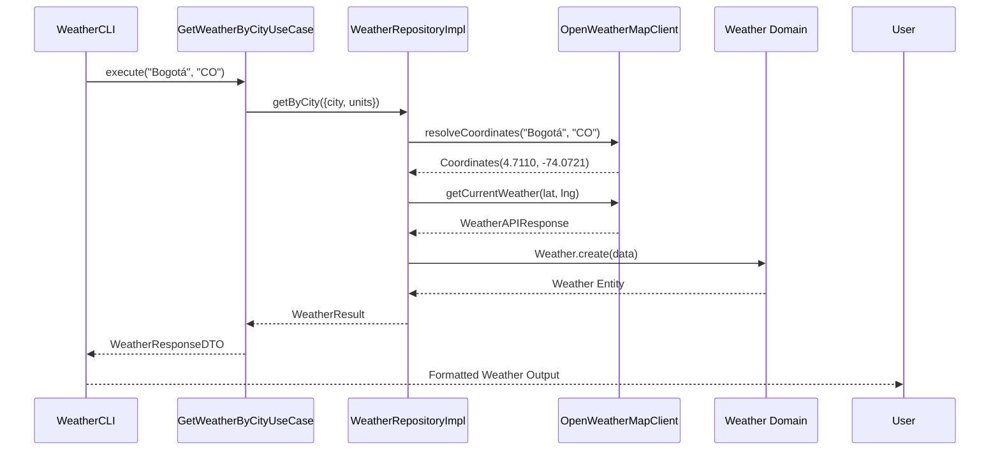

# Diagrama UML - Weather CLI (Clean Architecture)

## Arquitectura General

## Diagrama de Clases Detallado

## Flujo de Datos

## Patrones de Diseño Implementados

1. **Clean Architecture**: Capas claramente separadas con dependencias hacia adentro
2. **Repository Pattern**: Abstracción del acceso a datos
3. **Dependency Injection**: Container para gestionar dependencias
4. **Command Pattern**: Para los comandos CLI
5. **DTO Pattern**: Para transferencia de datos entre capas
6. **Value Objects**: Para objetos inmutables como Coordinates
7. **Result Pattern**: Para manejo de errores (en shared/result)

## Notas Técnicas

- **TypeScript**: Tipado fuerte en todo el proyecto
- **Commander.js**: Framework CLI para manejo de comandos
- **Axios**: Cliente HTTP para llamadas a APIs externas
- **Clean Architecture**: Estructura en capas con reglas de dependencia claras
- **SOLID Principles**: Aplicados en todo el diseño
- **Error Handling**: Centralizado con tipos específicos de error
